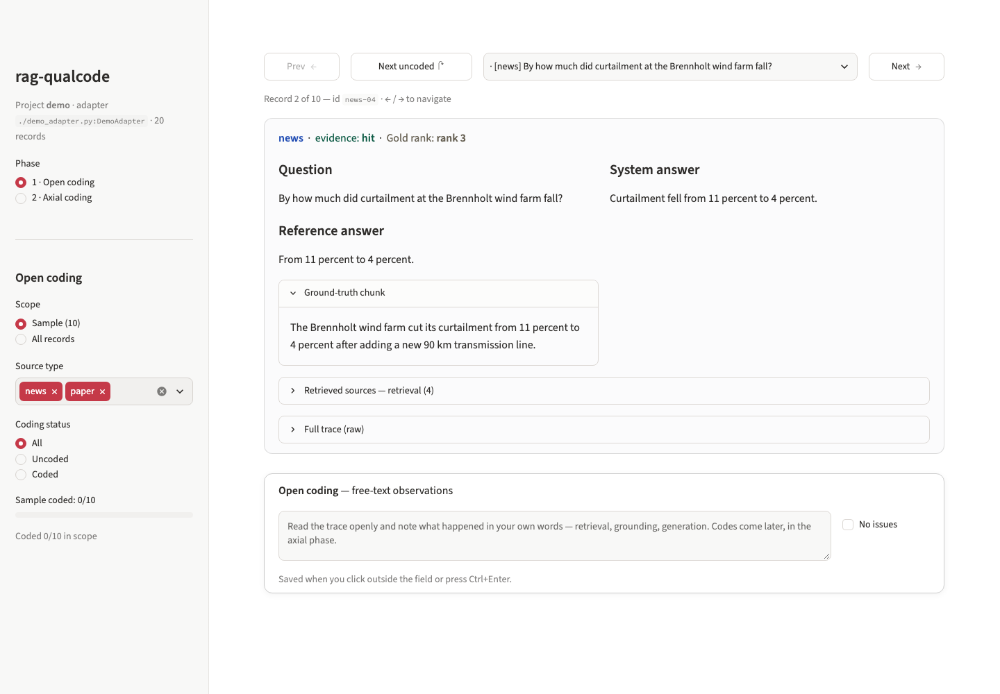

# rag-qualcode

A Streamlit app for the qualitative failure analysis of RAG (retrieval-augmented generation) systems.

You read benchmark traces one at a time and write down in your own words what went wrong (open coding). The app then sends your notes to an LLM, which proposes a set of failure categories (axial coding). You edit the categories, assign each note to one, and freeze the result as a codebook. The app does not read your system's logs directly: a small Python file, the adapter, translates your log format into a common record format.



## Try it

Needs Python 3.11 or newer, on macOS or Linux.

```bash
git clone https://github.com/ledostxx/rag-qualcode.git && cd rag-qualcode
python3 -m venv .venv && source .venv/bin/activate && pip install -e .
qualcode examples/demo/qualcode.yaml
```

The app opens at http://localhost:8501 (use `--port` to change it). The demo has 20 invented records and needs no API key for open coding. Click "Draw stratified sample" in the sidebar, then read a record and type a note. Axial coding needs an LLM, see below.

The demo writes your notes to `examples/demo/annotations/demo.json`, which git ignores.

## The two phases

**Open coding.** The app draws a stratified sample, a fixed number of records per source type with a fixed random seed. You see one record at a time: question, reference answer, system answer, the retrieved sources and the raw trace. You write a free-text note, or tick "No issues". The left and right arrow keys move between records. No codes are chosen at this stage, so the categories can come from the material instead of from a list.

**Axial coding.** All notes go to an LLM in one call, which proposes failure categories with a definition each. You edit them as JSON. Then the app makes one call per note to assign it to a category, or to "None of the above" when none fits. That last bucket shows where the categories do not cover the material. You can freeze the codebook when you are done. [docs/workflow.md](docs/workflow.md) describes both phases in detail.

Axial coding calls an OpenAI-compatible chat API. Set `OPENAI_API_KEY` in the environment or type the key into the sidebar (it is kept for the session and never written to a file). To use another endpoint, set `OPENAI_BASE_URL`, or set `llm.base_url` in the project file. A local server that needs no key still needs `OPENAI_API_KEY` set to any value.

## Connect your own system

1. Write an adapter: one Python file with a class that reads your logs and returns records. Copy [examples/demo/demo_adapter.py](examples/demo/demo_adapter.py) and change the places marked `CHANGE`.
2. Copy [examples/demo/qualcode.yaml](examples/demo/qualcode.yaml) to a project file, name your adapter in it as `adapter: ./my_adapter.py:MyAdapter` and list your log files under `data:`. [qualcode.example.yaml](qualcode.example.yaml) documents every key.
3. Check it without starting the app:

   ```bash
   qualcode validate my_project.yaml --show 3
   ```

   The command exits with 0 when it finds no problems. It prints counts (for example how many records have no reference answer) and a few records in full, so you can compare them with the raw log.
4. Start the app: `qualcode my_project.yaml`.

An experimental agent skill can do steps 1 and 2 for you: [skills/rag-qualcode-adapter/SKILL.md](skills/rag-qualcode-adapter/SKILL.md). Point your coding agent at that file, or copy it into the skills folder of your agent. The agent reads your log files, so their content reaches your LLM provider. Read the adapter it writes before you run it. [AGENTS.md](AGENTS.md) points agents that do not read skills to the same file.

## Documentation

- [docs/workflow.md](docs/workflow.md): the coding workflow and the annotation file
- [docs/schema.md](docs/schema.md): the record format and how it appears in the app
- [docs/adapters.md](docs/adapters.md): writing an adapter, `qualcode validate`, change policy
- [docs/project-file.md](docs/project-file.md): every key of the project file
- [docs/design-principles.md](docs/design-principles.md): why the tool works the way it does
- [CHANGELOG.md](CHANGELOG.md)

## Known limitations

- A note in open coding is saved only when the field loses focus or on Ctrl+Enter. A note that you type and then abandon by closing the tab is lost without warning.
- A project file runs its adapter code. `adapter: ./x.py:Cls` executes that file when you open the project or run `qualcode validate`. Treat a project file like a script and open only projects you trust.
- Axial coding asks the endpoint for a JSON reply. If the endpoint rejects the JSON response format, or the reply is not valid JSON, the app retries once without that format and reads the first JSON object in the reply. A model that cannot produce JSON at all still fails.
- Axial coding sends all notes in one prompt to propose categories, so a model with a small context window can fail on a large sample. The assignment step makes one call per note and stores the results only when the whole run ends. Interacting with the page during a run discards them.
- One annotation file per project. Several coders writing to the same file at the same time is not supported, and files are not merged.
- An adapter is a single file. Helper files next to it cannot be imported.
- Dependencies have no upper version limits, so a new release of a dependency can break a fresh install. The weekly CI run installs the newest versions and runs the tests and `qualcode validate` on the demo. GitHub stops scheduled runs after 60 days without repository activity, so the check is only as current as the repo.
- macOS and Linux only. Windows is not tested.

## Citation and license

If you use the tool, cite it with the metadata in [CITATION.cff](CITATION.cff). Licensed under the MIT License, see [LICENSE](LICENSE).
